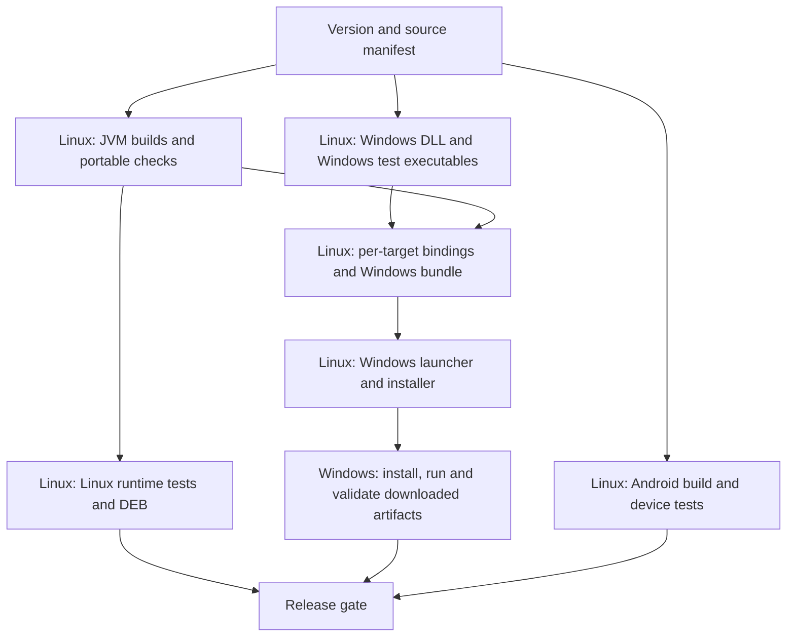

# Building Gilune for Windows primarily on Linux

Investigation completed 10 September 2026 against `c429358`.
Original status on 10 September: source/artifact inspection and feasibility recommendation.
Implementation update, 11 September: the Linux-built Windows DLL, JVM artifacts,
Rust launcher and MSI have passed local Windows validation. See
[the implementation and remaining release gate](linux-windows-build.md).
Launch4j was rejected during implementation because its Java-version parser
crashes with quoted `JAVA_TOOL_OPTIONS`; the candidate uses a small Rust launcher.

## Recommendation

Move desktop compilation and bundle assembly to Linux. Keep a Windows job that
consumes those exact artifacts and tests their behaviour. No application-language
or UI-framework rewrite is needed to pursue this.

Prototype the Windows native DLL first using `cargo-xwin` with the existing MSVC
target. Then build a Windows application directory on Linux, using target-specific
runtime dependencies, a downloaded Windows Java runtime, and a Launch4j launcher.
Try `wixl` for the installer first to preserve MSI distribution and the existing
upgrade family. Use NSIS as the alternative if the required MSI behaviour proves
too expensive to maintain with wixl. Both routes can build Windows installers on
Linux without paying for a packaging service.

Do this in stages. Initially retain the full Windows test coverage while changing
where compilation happens. Only subsequently narrow repeated portable tests after
an explicit coverage review. Moving compilation and removing tests are different
decisions; the installer replacement alone cannot eliminate the present Windows
test time.

## What actually requires Windows?

| Component | Can be produced on Linux? | Change needed |
| --- | --- | --- |
| Kotlin/JVM application and plugins | Yes in principle | Export application JARs separately from the host runtime; resolve Windows dependencies explicitly |
| Windows `gilune_ffi.dll` | Supported cross-toolchain route exists; Gilune unproven | LLVM/clang-cl/lld, Windows SDK/CRT, Rust MSVC target, CMake/Ninja and dependency fixes |
| Windows UniFFI bindings | Expected with the host generator reading the Windows DLL metadata; verify in prototype | Generate from that exact DLL and keep the binary/bindings together |
| Java runtime | Download Windows binaries on Linux | Pin runtime version and checksum; distribute notices; verify runtime dependencies |
| Windows EXE launcher | Yes, Launch4j supports this | Explicit classpath, bundled JRE, application icon and launcher properties |
| MSI installer | Yes, with a different tool such as wixl | Own MSI authoring and prove upgrades, shortcuts, uninstall and repair |
| EXE installer | Yes, NSIS supports this | Own installer script and migration from existing MSI installations |
| Windows filesystem, renderer and installation tests | Must execute on real Windows for trustworthy Windows evidence | Download prebuilt artifacts and execute tests; avoid recompilation there |

The existing restriction is specific to Compose's native-distribution task, which
uses jpackage and requires a compatible host for each installer format. It is not
a general inability to compile JVM applications for Windows on Linux. Its
`packageUberJarForCurrentOS` also bundles the current OS's dependencies, so copying
a Linux uber-JAR into a Windows installer would be the wrong shortcut.
[Compose packaging documentation](https://kotlinlang.org/docs/multiplatform/compose-native-distribution.html)

## Evidence from this repository

- `app/composeApp/build.gradle.kts` uses `compose.desktop.currentOs`. Native
  distribution, app compilation, test execution and runtime selection currently
  sit in the same Gradle project. Split the artifact-export tasks from packaging;
  replacing only the final `packageReleaseMsi` command is insufficient.
- `pluginSdk` depends on `kernelBindings`; Tasks and People use that SDK. Export
  all project JARs, not just `composeApp-desktop.jar`, and their external runtime
  dependencies. Keep Skiko's Windows native runtime separate from Linux's.
- Inspection of the existing local `composeApp-desktop.jar` found 609 class files,
  `MainKt`, no nested dependency JARs and no DLL/SO/dylib entries. This supports the
  thin-JAR boundary; it does not prove this older artifact is the current candidate
  or that the full dependency bundle is portable.
- `Main.kt` adds `compose.application.resources.dir` to `jna.library.path`.
  A replacement launcher must supply a path relative to its installed location,
  including spaces/non-ASCII paths, not a developer or runner directory.
- Existing launcher configuration also includes Swing globals, Skiko library
  location, SerialGC, heap limits and compiler-thread limits. Preserve the intended
  current Gradle settings. The locally inspected packaged image contains Compose
  1.7.3 dependencies, so it is evidence of layout only, not the latest 1.8.2 runtime.
- The MSI upgrade family is `c077b799-5193-4ce3-b93a-411c67e29e37`. Preserve and test
  it when retaining MSI. Giving an NSIS installer the same string does not make it
  an MSI major upgrade; that transition needs explicit migration handling.
- `architecture/07-compatibility.md` requires per-target binary/bindings provenance.
  Recent parity checks do not justify assuming every future target is identical.

## Native cross-compilation: the main technical experiment

`cargo-xwin` documents Linux-to-Windows MSVC compilation using clang, SDK/CRT
downloads and CMake toolchain generation; Ninja is needed for CMake integration.
Its wrapper is MIT licensed; use of the Microsoft SDK/CRT is subject to Microsoft's
terms, rather than becoming MIT licensed. Pin the compiler, SDK/CRT and wrapper
versions in the eventual build environment.
[cargo-xwin documentation](https://github.com/rust-cross/cargo-xwin)

The representative experiment is:

```sh
cargo xwin build --locked --release --target x86_64-pc-windows-msvc \
  --manifest-path kernel/Cargo.toml -p gilune-ffi --features whisper
```

This is a proposed command, not a command successfully executed in this investigation.
Use an isolated target directory; build the Linux generator separately and give it
the resulting Windows DLL as metadata input. Do not try to load that DLL into a
Linux JVM. Compile Windows Rust test executables with `cargo xwin test --no-run`
and export their paths from Cargo's machine-readable messages, with all required
fixtures, rather than asking the Windows validator to rebuild them. The CLI
crash/multiprocess tests also need the corresponding CLI executable and working
directory layout. Validate these details before replacing `cargo test` in CI.

The pinned `whisper-rs-sys` 0.15.0 build script contains:

```rust
if cfg!(target_os = "windows") {
    config.cxxflag("/utf-8");
    println!("cargo:rustc-link-lib=advapi32");
}
```

This condition describes the host compiling the build script, not Cargo's `TARGET`.
On a Linux host it omits these Windows settings even while targeting Windows.
The bundled `ggml-cpu.cpp` contains actual Windows registry calls, so investigate
the final link requirements rather than assuming the omission is harmless. A
target-aware dependency patch may be required; this is not yet a reproduced link
failure. Do not reuse the Android build's empty `advapi32` stub: Windows needs real
Windows libraries. Also verify bindgen's target headers, bundled SQLite compilation,
C++ runtime imports, OpenMP configuration and portable CPU instruction selection.

Retain MSVC initially. MinGW is an alternative to investigate only if necessary;
changing compiler/runtime family introduces another native compatibility variable.
Keep the selected CPU feature baseline compatible with supported user machines,
and inspect DLL imports instead of relying on runtimes installed on CI runners.

## Bundle and installer choices

| Approach | Cost and effort | Assessment |
| --- | --- | --- |
| Keep jpackage MSI on a thin Windows packaging job | No new tool fee; lowest transition effort | Useful first milestone; Linux supplies app/DLL/test artifacts, Windows still packages |
| Launch4j + wixl on Linux | Free/open-source tools; medium-to-high authoring effort | Preferred installer prototype because MSI and its upgrade family can be retained |
| Launch4j + NSIS on Linux | Free tools usable for commercial software; medium effort plus migration | Strong fallback; EXE installer rather than MSI, with explicitly authored upgrade/uninstall behaviour |
| Hydraulic Conveyor | Cross-platform packaging with JVM support; paid for commercial distribution unless eligible for its open-source offer | Technically relevant but not the default under the no-paid-builds requirement |

Launch4j can produce a Windows launcher on Linux and locate a bundled JRE. Use its
supported GUI launcher with a 64-bit Java runtime; its experimental JNI headers are
32-bit and inappropriate here. It supports an external JAR/classpath, so there is
no need to flatten every dependency into one huge JAR. Preserve JVM options and
derive paths from the executable location. Validate the resulting process/shortcut
identity and error reporting, as these can differ from jpackage's launcher.
[Launch4j overview](https://launch4j.sourceforge.net/),
[launcher configuration](https://launch4j.sourceforge.net/docs.html)

Start by bundling a pinned Windows Temurin 17 JRE archive, obtained on Linux and
verified against its checksum. No Java compilation is required to download it.
This removes Windows jlink from the initial experiment, at the possible cost of a
larger runtime. Compare package size with the existing trimmed runtime before
release; runtime trimming can be a separate optimization.
[Adoptium API cookbook](https://github.com/adoptium/api.adoptium.net/blob/main/docs/cookbook.adoc)

GNOME's wixl builds MSI files from WiX-like XML. Its current source includes
`MajorUpgrade`, upgrade-table handling, registry values and shortcuts. This is
stronger evidence than assuming it only makes trivial MSIs, but it is not proof
that every jpackage-generated WiX extension is supported. Write a small deliberate
manifest instead of treating generated WiX as a drop-in input. Validate scope,
architecture, product/component identity, removal ordering and downgrade blocking
against the actual released MSI.
[msitools](https://wiki.gnome.org/msitools),
[wixl schema](https://raw.githubusercontent.com/GNOME/msitools/master/tools/wixl/wix.vala),
[upgrade implementation](https://raw.githubusercontent.com/GNOME/msitools/master/tools/wixl/builder.vala)

NSIS explicitly supports compiling Windows installers on Linux. Its licensing
permits commercial applications. For Gilune it needs files, Start menu shortcuts,
uninstall registration and upgrade handling. Keep vault data outside installer-owned
deletion scope. If changing from MSI, handle existing installations through Windows
Installer and test failure/rollback paths; do not just overwrite its directory.
[NSIS compiler](https://nsis.sourceforge.io/Docs/Chapter2.html),
[NSIS licence](https://nsis.sourceforge.io/Docs/AppendixI.html)

Conveyor supports packaging Windows apps from other operating systems, but its free
commercial trial/local-only configuration is not free production distribution.
Its documented open-source exemption has source-publication and attribution terms;
do not assume a private repository qualifies just because its files say MIT.
[Conveyor FAQ](https://conveyor.hydraulic.dev/21.1/faq/)

Signing does not inherently require Windows either: osslsigncode supports
Authenticode signing of EXE/DLL/MSI on platforms with OpenSSL/cURL. Certificate
acquisition and hardware/provider access are separate constraints; changing tools
does not supply a trusted signing identity or guarantee removal of SmartScreen
prompts. Preserve the existing signing policy unless separately changed.
[osslsigncode](https://github.com/mtrojnar/osslsigncode)

## Proposed job layout and artifact boundaries



The diagram describes responsibilities, not a requirement to create eight separate
paid runner jobs. Combine Linux work where caches/outputs can be reused. Avoid
copying multi-GB Cargo/Gradle trees merely to save a small compile step.

Export a versioned manifest containing commit, version, target, toolchain identifiers,
dependency versions and hashes of the DLL, generated bindings, project JARs and
runtime files. The Windows validator must run the exact package that would ship.
Reuse common JVM compilation only after proving the binding/API boundary matches;
if target bindings differ, compile the two variants on Linux in isolated source and
output directories. Two cheap Linux compilations are preferable to a mismatched
native boundary. Rework the bindings-parity job to compare Linux-host-generated
target artifacts; retain the provenance rule even when their bytes match.

## Windows validation to retain

Initially retain the present Rust and desktop suites, using precompiled test
artifacts. Add installation evidence: clean install, launch with no system Java,
native FFI operation, save/reopen, upgrade from the released MSI, Start menu launch,
uninstall, and preservation of vaults/preferences. Run installer tests on disposable
Windows CI/VM instances, not the owner's normal installation.

Windows-specific risks already exist in source: directory flushing and writable
file handles in `fs.rs`, lock contention in `index/tests.rs`, hard-link publication
versus Linux rename semantics, path handling, and the outstanding renderer/lifecycle
regressions. Retain these in a focused Windows gate if portable tests are later
consolidated. Wine can help development, but does not establish real Windows
filesystem, graphics or Windows Installer correctness.

Large query/index fixtures are candidates for faster setup or portable-only heavy
coverage with smaller Windows boundary cases. Keep their scale assertions on Linux;
do not quietly shrink datasets or hide failure cases to claim a speedup. The exact
test split requires a test-by-test review, not a broad removal of `cargo test`.

## Runner-minute impact

Measured reference: [run 34386963569](https://github.com/Gilune/gilune/actions/runs/34386963569).
It failed Android validation, so it is a timing reference, not a release success.

| Existing Windows step | Measured duration |
| --- | ---: |
| Native release DLL compilation | 3m 13s |
| Kernel suite, including test compilation | 10m 51s |
| Of that, test compilation | 1m 41s |
| Desktop compilation and tests | 3m 42s |
| MSI packaging | 1m 56s |
| Setup/uploads/remaining work | Approximately 2m |

All platforms used approximately 85 runner minutes: Windows 22, Linux desktop 23,
Android 40. Android's new native-output cache could reduce that to approximately
73 on a matching hit. Those cache savings remain estimates, not measured warm runs.

Replacing only MSI creation moves about two minutes from Windows to Linux; it does
not save 22 minutes. If two Linux minutes replace two Windows minutes, total runner
time stays 85. At the currently documented baseline rates of $0.010/Windows minute
and $0.006/Linux minute, that changes the rate-weighted value from about $0.598 to
$0.590. These are comparison values, not a bill or a proposal to enable spending.
[GitHub runner rates](https://docs.github.com/en/billing/concepts/product-billing/github-actions#baseline-minute-costs)

An illustrative longer-term scenario is Windows 6 minutes, Linux desktop/common
work 30, Android 40: **76 total**, or **64 with the assumed Android cache hit**.
This assumes 16 Windows minutes removed but seven Linux minutes added, and requires
both artifact reuse and a reviewed focused Windows test gate. Its rate-weighted
value is about $0.480, roughly 20% below the old cold baseline. **This is a target
scenario, not a forecast.** New install/upgrade tests and cold SDK downloads can
increase it. Keeping all current Windows tests initially means much smaller savings.

## Implementation sequence and decision gates

1. **Cross-native spike (medium/high uncertainty):** provide a working Linux
   environment; pin cargo-xwin/LLVM/SDK; build the full whisper-enabled DLL; generate
   its bindings on Linux; inspect PE imports; execute FFI/transcription smoke tests
   on Windows. A plain hello-world DLL is not sufficient evidence.
2. **Bundle export (medium effort):** add Gradle export tasks for project JARs,
   Windows runtime dependencies and precompiled desktop tests. Version both target
   manifests consistently. Prove the exported bundle on Windows before changing
   installer ownership. Keep current Windows-built artifacts as a comparison.
3. **Installer spike (medium/high effort):** Launch4j plus bundled JRE, then wixl
   with the existing MSI upgrade family. Prove clean install/upgrade/uninstall.
   If wixl cannot provide required behaviour cleanly, compare the cost of explicit
   NSIS migration with retaining the roughly two-minute Windows MSI task.
4. **Move production work (medium effort):** Linux supplies Windows binaries;
   Windows downloads and tests them. Preserve current full test coverage initially,
   exact artifact provenance, release gates, failure logs and cold-cache support.
5. **Optimize validation (separate coverage review):** remove duplicate portable
   work only after Windows-specific boundaries and historical regression coverage
   are explicitly mapped. Measure summed job seconds and rate-weighted usage for
   cold native changes, warm app-only changes, and a release before accepting savings.

This recommendation does not require paying for builds, publishing the repository,
replacing Compose/Rust, or discarding Windows tests.

## What was and was not verified at the 10 September investigation cutoff

Verified locally: build/source boundaries, pinned whisper dependency source and
its host/target conditional, actual Windows registry calls in bundled GGML, the
thin application JAR contents, launcher layout, existing MSI upgrade UUID, and
successful Windows job timing logs. Primary documentation/source establishes the
proposed tools' cross-platform capabilities.

No end-to-end Linux-built Windows DLL or installer was produced. The installed
Ubuntu WSL registration points to a missing `ext4.vhdx`; attempting to launch it
fails with `ERROR_PATH_NOT_FOUND`. Docker's server API also returned an error.
Initial sandbox access failures were rechecked with permission, exposing these
environment failures. No distribution was installed/reset and no virtual disks
were modified. No paid/hosted builds were started, and no application, workflow,
release or signing changes were made by this investigation. The next technical
proof requires a functioning Linux environment; the source-level investigation is
complete and the remaining prototype gates are explicit.
