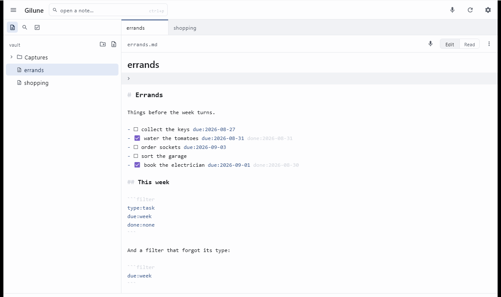

<p align="center"></p>

<h1 align="center">Gilune</h1>

<p align="center">Capture a thought. Keep it in plain files.</p>

<p align="center"></p>

Gilune is a notebook for the things you want to remember. You write or you speak,
and what you keep is saved as an ordinary Markdown file in a folder you chose —
readable today, readable in ten years, and readable by any other editor you point
at it. Everything runs on your own machine: there is no account, and speech is
transcribed locally. Features arrive as plugins you can switch off or remove, and
removing one takes away its buttons without touching a word you wrote.

## What it does

- **Capture by typing or by speaking** — a new note in one keystroke, or press the
  microphone, talk, and get the note it makes.
- **Dictate at the cursor** while writing, straight into the note you have open.
- **Local transcription** — your voice never leaves the machine, and the original
  recording is always kept beside the note.
- **Plain Markdown files** in a folder you choose, styled as you type without ever
  changing the bytes on disk.
- **Autosave** — there is no save button and never a lost paragraph.
- **Tasks from any checkbox**, with due dates you type in words (`tomorrow`,
  `friday`) and Gilune stores as real dates.
- **An agenda** of what is overdue, due today, due this week, or undated.
- **Search with a small query language** — phrases, exclusions, `file:`/`path:`/
  `content:`, properties, and `type:task` with `due:`/`done:`/`is:`.
- **Live filter blocks** inside a note, which stay legible code blocks anywhere else.
- **Tabs and split panes**, dragged where you want them, remembered per vault.
- **Plugins with visible permissions** — nothing reaches the network without an
  explicit yes.
- **Works alongside Obsidian** or any other editor pointed at the same folder.

## Documentation

The user guide lives at **[gilune.github.io/gilune](https://gilune.github.io/gilune/)**.

- [Capture &amp; voice](https://gilune.github.io/gilune/guide/capture.html) — making
  notes by speaking, dictating at the cursor, and how local transcription is set up.
- [Tasks](https://gilune.github.io/gilune/guide/tasks.html) — the `/` menu for due
  dates, the agenda, and live filter blocks.
- [Search](https://gilune.github.io/gilune/guide/search.html) — the complete query
  language, with an example for every keyword.
- [Workspace](https://gilune.github.io/gilune/guide/workspace.html) — tabs, split
  panes, and every keyboard shortcut in one table.
- [Plugins](https://gilune.github.io/gilune/guide/plugins.html) — permissions, and
  what does and does not happen when you remove one.

## Status

The **Windows desktop app** is what exists and works today: writing, voice capture
with local transcription, tasks, search, tabs and split panes. An **Android app** is
in development and not ready to use. **Syncing between devices** is being designed
and is not built yet — until it is, your vault is simply a folder, so back it up and
copy it like any other.

Packaged builds are published on the
[Releases page](https://github.com/Gilune/gilune/releases): an installer for
Windows (`.msi`), a package for Debian-family Linux (`.deb`), and an Android APK
to sideload. Windows is the platform Gilune is developed and used on; the Linux
and Android packages are built by the same pipeline but are not yet anybody's
daily driver. Building from this repository works too, and is described below.

## Building from source

You will need **JDK 17+**, a **Rust toolchain** (1.98+), and — because the
transcription engine compiles from C++ — **LLVM and CMake**. On Windows that is
`scoop install llvm cmake`, with `LIBCLANG_PATH` pointing at the LLVM `bin`
folder; on Debian-family Linux it is
`sudo apt-get install libclang-dev cmake`.

On **Windows**:

```
cd kernel
cargo build --release -p gilune-ffi --features whisper

cargo run -p gilune-ffi --bin uniffi-bindgen -- generate ^
  --library target/release/gilune_ffi.dll --language kotlin ^
  --out-dir ../app/kernelBindings/src/desktopMain/generated

copy target\release\gilune_ffi.dll ..\app\composeApp\resources\windows-x64\

cd ../app
gradlew :composeApp:createReleaseDistributable
```

On **Linux** — the same three steps, with the shared library's own name and its
own resource folder:

```
cd kernel
cargo build --release -p gilune-ffi --features whisper

cargo run -p gilune-ffi --bin uniffi-bindgen -- generate \
  --library target/release/libgilune_ffi.so --language kotlin \
  --out-dir ../app/kernelBindings/src/desktopMain/generated

mkdir -p ../app/composeApp/resources/linux-x64
cp target/release/libgilune_ffi.so ../app/composeApp/resources/linux-x64/

cd ../app
./gradlew :composeApp:createReleaseDistributable
```

The app lands at
`app/composeApp/build/compose/binaries/main-release/app/Gilune/Gilune.exe`
(`.../app/Gilune/bin/Gilune` on Linux). Swap the last task for
`packageReleaseMsi` or `packageReleaseDeb` to build an installer instead of a
folder you run in place. On first run, choose a vault folder in Settings — an
empty one is fine. Voice notes need a 57 MiB speech model, which is downloaded
only after you allow the transcription plugin network access under Settings ▸
Plugins.

## For developers

- Product principles: [`sources/README.md`](sources/README.md) — the "why".
- Architecture package: [`architecture/README.md`](architecture/README.md) —
  constitution → contracts → decision records. Read its README first.
- Evidence and prototypes: [`spikes/`](spikes/) — each states what it proved and
  where it is still honest about gaps.

## License

Licensed under the [MIT license](LICENSE)
([ADR 0009](architecture/decisions/0009-licensing.md)). Unless you
explicitly state otherwise, any contribution intentionally submitted for
inclusion in this work by you shall be licensed as above, without any
additional terms or conditions.
